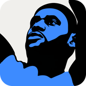

# NBA2KHUB Mod Tool

An English, re-themed build of the classic **3DM NBA2K12 MOD Tool** for editing NBA 2K `.iff`
cyberface/texture files — with a modern UI, file tabs, and one-click "grow a texture to 1024/2048"
import. Built for the [nba2khub.app](https://nba2khub.app) modding community.



## Features

- **Fully English UI** — every menu, button, label, dialog and error message translated.
- **Modern layout** — electric-blue/black theme (light theme included), redesigned texture browser,
  resource inspector, and a searchable texture/model list.
- **File tabs** — open several `.iff` files at once and switch between them.
- **Smart Replace (RED MC-style)** — import a texture of *any* size into a slot and it grows the slot
  to fit (512 → 1024 → 2048), re-encoding to the slot's DXT format automatically, instead of crashing.
- **Works on older Windows** — falls back to text-only buttons when the modern icon font is missing.
- Everything the original tool does: browse/preview textures, 3D model preview, export/replace textures
  and models, save/save-as.

## Requirements

- Windows 7 or later, with the original tool's runtimes: **.NET Framework 4.0+**, **Visual C++ 2008 SP1 +
  2010 (x86)** redistributables, and **DirectX 9 (June 2010)** (for `D3DX9_43.dll`).
- **Smart Replace / grow-to-1024**: the standalone download bundles everything it needs. (If you run
  the exe-only build, it instead looks for `replace_tex.exe` next to the app, or falls back to a system
  Python 3 with `numpy` + `pillow`.) The rest of the tool works regardless.

## Install / run

Two downloads on the [Releases](https://github.com/BlueCode10/nba2khub-mod-tool/releases) page:

- **Standalone ZIP (recommended)** — extract it and run `NBA2KHUB Mod Tool.exe`. The `replace_tex`
  folder next to it bundles Python + numpy + pillow, so the **grow-to-1024 import works with nothing
  else installed.**
- **Exe only** — smaller, but the grow-to-1024 import needs Python 3 (numpy + pillow) on the PC; the
  rest of the tool works without it.

Either way the app unpacks the editor core and its DLLs to `%LOCALAPPDATA%\3DM NBA2K12 MOD Tool` on
first run. Your game files are never touched unless you Save.

## Build

Needs the .NET Framework C# compiler (ships with Windows). From a Git Bash shell:

```bash
bash build.sh
```

This produces `dist/3DM NBA2K12 MOD Tool.exe` with the editor core and DLLs embedded.

## Credits & notice

This is a wrapper/re-skin built on top of the original **3DM NBA2K12 MOD Tool** by 3DMGAME
(www.3dmgame.com). The files in `payload/` (`NBA2K12ModCore.exe`, `DXRender_4.dll`, `zlib.dll`) are the
original tool's binaries and remain the property of their respective authors; they are bundled so the
wrapper can run. All original texture/model editing is performed by that original code.

The wrapper source in `src/` is by [BlueCode10](https://github.com/BlueCode10).
